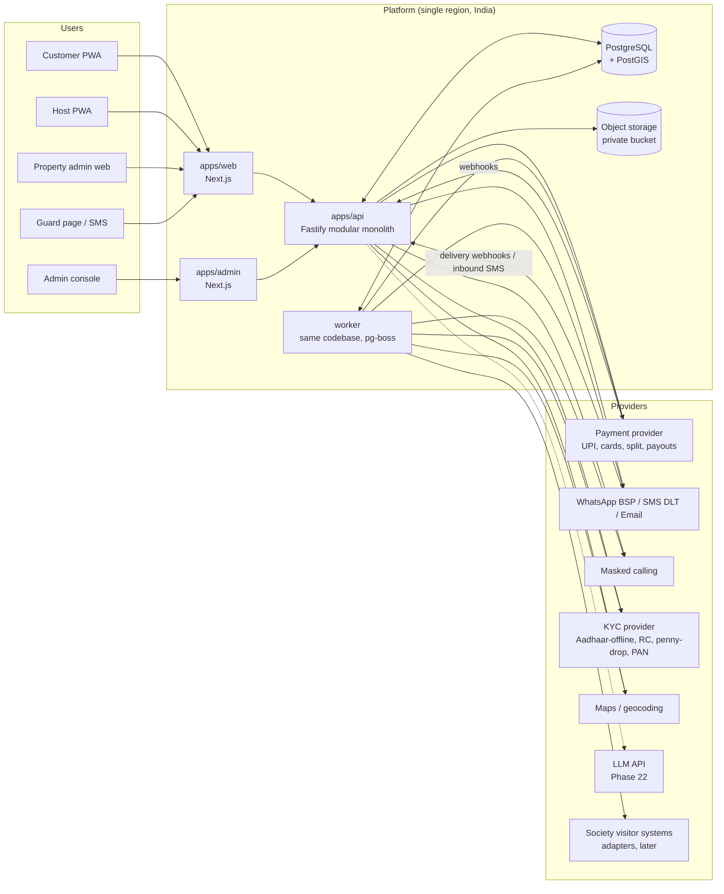
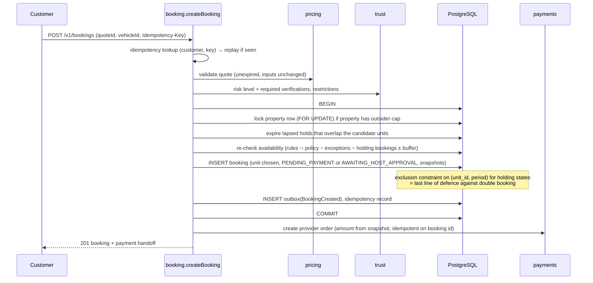

# Technical Architecture

Phase 5 output (2026-10-19). Production architecture for the pilot and beyond: a **modular monolith** (CLAUDE.md §24, D-002). It covers the technology stack, module boundaries, data ownership, external integrations, the request, booking, payment, notification, AI and error flows, background jobs, security, observability, environments and the testing strategy. The physical schema is in Phase 6 (`database-design.md`), and the build starts in Phase 7.

Inputs: [domain-model.md](domain-model.md), [ux-architecture.md](ux-architecture.md), [trust-and-safety.md](trust-and-safety.md), [decision-log.md](decision-log.md) (D-002, D-003, D-008, D-020, D-021, D-029, D-030).

---

## 1. Architectural drivers

| Driver | Consequence |
|---|---|
| Correct booking and money under concurrency | PostgreSQL transactions, DB constraints, idempotency everywhere, transactional outbox |
| Trust and privacy (residential locations, PII) | Field-level encryption, strict response shaping per audience, admin isolation, audit |
| Small team, pilot scale (one city) | One deployable backend, one database, no Redis, Kafka or microservices until evidence demands it |
| Mobile-first, low install friction | A PWA (D-020) plus server rendering for SEO pages |
| India-specific integrations (UPI, WhatsApp, DLT-registered SMS, masked calling, Aadhaar-offline KYC) | Provider abstractions with one adapter each at launch |
| Future asset types and access mechanisms | Asset-type registry, access adapters and charger integrations as plugins behind interfaces |
| AI later, never authoritative | A dedicated AI module calling application tools through the same authorisation as users (Phase 22) |

---

## 2. Technology stack (resolves D-008)

| Concern | Choice | Why / alternatives considered |
|---|---|---|
| Language | **TypeScript 6.0** (strict) everywhere. TS 7 (native compiler) is deferred until typescript-eslint supports it. | One language across API, web and shared types. Strong ecosystem for payments, maps and messaging providers. |
| Runtime | **Node.js 24 LTS**, running TypeScript **natively** (type stripping), with no build step for the API | Current LTS line. Phase 7: native execution removes a compiler/bundler from the API toolchain. Constraint: erasable syntax only (no `enum`, no parameter properties), enforced by `erasableSyntaxOnly` and lint (D-047). |
| Backend HTTP | **Fastify** | Fast, schema-first, mature plugin model. NestJS was rejected: its DI and decorator weight isn't needed. Modules are enforced by folder structure and lint rules instead (§4). |
| Validation / contracts | **Zod** schemas, generating the **OpenAPI 3.1** spec | One source for runtime validation, types and API docs |
| Database | **PostgreSQL 17** with **PostGIS** and **btree_gist** | Geo search (Phase 10), range-exclusion constraints against double booking (BR-08), JSONB for type details, mature transactions |
| DB access | **Kysely** (type-safe SQL builder) + **plain SQL migrations** | Full control over exclusion constraints, PostGIS, partial indexes and `FOR UPDATE`. ORMs (Prisma, TypeORM) handle these awkwardly. Drizzle was a close alternative. |
| Cache | **No cache server at pilot.** CDN caching for public static assets and locality pages (never for personalised or availability responses). In-process memoised read-only config (versioned PlatformConfig, asset type registry). | Availability must never be served stale (CLAUDE.md §13). Redis is added only under the §11 triggers. |
| Background jobs and scheduling | **pg-boss** (Postgres-backed queue with cron and singleton jobs) | No extra infrastructure. Jobs are transactional with the database. Revisit if throughput demands it. |
| Time handling | Postgres `timestamptz` / `tstzrange` + **Luxon** for asset-timezone rule expansion | Correct IANA timezone handling (BR-03) |
| Web app (customer, host, property admin) | **Next.js (React)** as a PWA, server-rendered public pages (locality and listing pages for SEO), client-side app for authenticated flows | One app for the D-020 surfaces. Server rendering for acquisition pages. |
| Admin console | **Separate Next.js app** on its own origin (`admin.` subdomain), sharing a UI package | Origin isolation of admin sessions and CSP (§9) |
| Guard surface | A server-rendered page inside the web app (`/g/{token}`), no client JS required | Works on basic phones (G-01) |
| Styling / UI | Tailwind CSS + a small shared component library | Fast, consistent, accessible primitives |
| Testing | **Vitest** (unit and integration), real Postgres via Docker / Testcontainers, **Playwright** (e2e) | Concurrency tests need a real database (no mocks for booking) |
| Lint / format | ESLint 10 flat config (typescript-eslint strict, `eslint-plugin-boundaries` v7 for module rules, Next plugin), Prettier | Module boundaries enforced mechanically and **proven by tests** (Phase 7: `module-boundaries.test.ts`) |
| Monorepo | **pnpm workspaces** | `apps/api`, `apps/web`, `apps/admin`, `packages/contracts`, `packages/ui`, `packages/config` |

Not used, deliberately (CLAUDE.md §31): microservices, Kubernetes, Kafka or event streaming, Redis (until §11 triggers), vector database, GraphQL.

---

## 3. System context



- **One backend codebase, two process roles:** `api` (HTTP) and `worker` (jobs and scheduled tasks). Both scale horizontally and statelessly.
- **Same-origin API:** the edge routes `/api/*` on each web origin (`app.` and `admin.`) to the API service, so session cookies are first-party and host-only (no cross-site cookies, minimal CORS), and server-rendered pages can forward the session. There's no direct database access from the frontends.
- Hosting is a single cloud region in India (proposed: AWS `ap-south-1`, Mumbai). It gives low latency, simplifies data-protection posture, and has managed Postgres with PostGIS. The final provider choice and infrastructure-as-code come in Phase 7 and 23.

---

## 4. Modules

### 4.1 Module map (CLAUDE.md §24)

| Module | Owns (domain-model entities) | Responsibilities |
|---|---|---|
| **identity** | User, RoleGrant, sessions, OTP challenges, admin permissions | OTP login, sessions, roles, admin 2FA, authorisation helpers |
| **users** | Vehicle, user profile, consents | Profiles, vehicles, consent records, data-rights requests |
| **properties** | Property, PropertyPolicy, PropertyMember, guard tokens | Property lifecycle, participation state, policies, society members, public-point generation (L-1) |
| **assets** | AssetTypeDefinition, Asset, AssetUnit, ParkingDetails, ChargerDetails, AssetMedia | Listing lifecycle, type registry, photos (with storage), publish preconditions |
| **availability** | AvailabilityRule, AvailabilityException | Rule expansion, the availability computation (BR-01 to BR-06) |
| **pricing** | Rate, Quote, PlatformConfig (fees and commission), CancellationPolicy | Deterministic quotes and refund calculations |
| **booking** | Booking, BookingSeries, BookingIssue | Booking engine, state machines, holds, recourse, series renewal |
| **payments** | Payment, Refund, provider events, reconciliation | Provider orders, webhooks, refunds, reconciliation |
| **ledger** (sub-module of payouts) | LedgerEntry, accounts | Double-entry postings, balances (D-016) |
| **payouts** | Payout, PayoutAccount | Earnings buckets, payout runs, holds |
| **access** | AccessGrant, AccessEvent, access adapters | Credentials, guard lookup, adapters (CODE, VEHICLE_NUMBER, QR, SOCIETY_VISITOR_SYSTEM) |
| **charging** | ChargingSession, ChargerIntegration adapters | Session lifecycle, MANUAL integration (pilot) |
| **notifications** | Notification, templates, delivery status | Channel routing (WhatsApp, SMS, email, push), dedup, retries, masked-call sessions |
| **reviews** | Review | Eligibility, double-blind publishing |
| **trust** | VerificationRecord, RiskSignal, RiskFlag, Restriction | Verification orchestration (VerificationProvider), risk rules, restrictions |
| **disputes** | Dispute, evidence | Dispute lifecycle, SLAs, appeals |
| **discovery** | (read models only) | Geo search over published assets plus availability, response shaping (public view) |
| **admin** | (no owned entities; admin-specific queries) | Admin API surface, maker-checker, PII reveal logging |
| **analytics** | `analytics` (anonymous search/view events) | Marketplace metrics computed read-only from the systems of record (Phase 21, docs/analytics.md, D-160) |
| **ai** | AI conversation logs, tool-call logs | Phase 22: tool gateway only |
| **platform** (shared kernel) | AuditEvent, outbox, idempotency keys, config access, clock, IDs, money and time types | Cross-cutting infrastructure |

### 4.2 Module rules
1. **Public interface only.** Each module exposes `index.ts` (service functions, types, events). Other modules may import only that. `eslint-plugin-boundaries` fails the build on deep imports.
2. **Data ownership.** Each module owns its tables, in a Postgres schema per module (for example `booking.bookings`, `payments.payments`). Only the owning module writes them.
3. **Cross-module reads** go through the owning module's service. Exception: **read-only query modules** (discovery, admin, analytics) may read other schemas through dedicated SQL views. They never write.
4. **Synchronous calls in-process; side effects through events.** A module emits domain events (`BookingConfirmed`, `PaymentSucceeded`, `IssueOpened`, …) into a **transactional outbox** in the same transaction as the state change. Workers deliver them to subscribers (notifications, analytics, ledger postings that aren't part of the core transaction). Delivery is at-least-once, so **every consumer is idempotent**.
5. **No module calls a provider SDK directly** except through its adapter interface in `platform/providers`.
6. **Authorisation lives in the module** that owns the resource (`booking.canView(actor, booking)`). Routes can't bypass it.

### 4.3 Code layout (backend)

```
apps/api/src/
  platform/        # db, outbox, jobs, idempotency, audit, errors, logging, config, crypto, providers/
  modules/
    booking/
      index.ts            # public API
      domain/             # state machines, rules (pure, unit-tested)
      application/        # use cases (transactions, authorisation)
      infrastructure/     # repositories (Kysely), job handlers
      http/               # routes + Zod schemas
    ...
  main.ts / worker.ts
```

Domain logic (state machines, BR rules, pricing math) is **pure TypeScript**, unit-testable without a database. Transactions and locking live in `application/`.

---

## 5. External integrations (provider abstractions)

| Interface | Operations | Pilot adapter (proposed) | Notes |
|---|---|---|---|
| `PaymentProvider` | createOrder, verifyWebhook, fetchPayment, refund, createTransfer / split, payout, fetchSettlements | **Razorpay** (UPI, cards, Route for split settlement, payouts), with Cashfree as the alternative | Final choice and commercial terms in Phase 15. HMAC-signed webhooks. |
| `MessagingProvider` | send(template, channel, recipient, vars, dedupKey), status webhooks, inbound | WhatsApp Business Platform via a BSP or Meta Cloud API. SMS via a **TRAI DLT-registered** sender and templates. Email via a transactional provider. | Every SMS template needs DLT registration before use (lead time, R-46) |
| `OtpProvider` | sendOtp, (verify is ours) | SMS (DLT) + WhatsApp authentication template | OTP codes are generated and hashed by **identity**, not the provider |
| `MaskedCallProvider` | createSession(partyA, partyB, ttl), endSession | An Indian cloud telephony provider | Session bounded to booking confirmation → end + 2 h (T&S §12) |
| `VerificationProvider` | aadhaarOffline/DigiLocker, faceMatch, rcLookup, pennyDrop, panVerify | One KYC aggregator (TS-5) | Results only stored (D-025) |
| `MapsProvider` | autocomplete, geocode, reverseGeocode, staticMap | Google Maps Platform (quality). Evaluate Mappls / Ola Maps on cost in Phase 10. | Exact points are never sent to the client for residential listings |
| `ObjectStorage` | putSigned, getSigned, delete | S3-compatible private bucket | All media private. Public listing photos served through short-lived signed URLs or a CDN with signed cookies. |
| `AccessAdapter` | issue, verify, revoke, events | CODE, VEHICLE_NUMBER, QR (pilot). SOCIETY_VISITOR_SYSTEM (later). | Phase 17 |
| `ChargerIntegration` | getStatus, startSession, stopSession, readEnergy | MANUAL | Smart chargers (OCPP or vendor APIs) later |
| `LlmProvider` | complete(messages, tools, schema) | Anthropic Claude API | Phase 22 only |

Each adapter has a **fake** implementation for local development and tests, and recorded-fixture contract tests against the real provider's documented payloads.

---

## 6. Key flows

### 6.1 Request flow

```
Client ──HTTPS──▶ Edge (TLS, WAF, CDN)
  ▶ Fastify
     1. request-id (accept X-Request-Id if trusted, else generate) → logger context
     2. security headers, body size limits (API is same-origin under /api; no cross-origin access)
     3. rate limit (per IP + per user + per route class)
     4. authenticate (session cookie → identity.resolveSession) → actor
     5. validate (Zod: params, query, body) → 400 problem+json on failure
     6. idempotency (POST mutations with Idempotency-Key: replay stored response)
     7. route handler → module application service
          - authorisation check (module-owned)
          - transaction (where needed) → domain logic → repository → outbox events
     8. response shaping per audience (public / customer / host / admin view models)
     9. structured access log (no PII, no secrets), metrics
```

### 6.2 Booking flow (BR-07 to BR-11, BR-33)



- **Unit selection:** among free units, pick deterministically (lowest label order) to keep allocation stable and testable. If two concurrent transactions pick the same unit, the loser hits the exclusion constraint and **retries with the next free unit** (bounded retries) before returning `409`.
- **Conflict on commit** (constraint violation or failed re-check): roll back, return `409 booking.unavailable` with alternatives computed outside the transaction.
- **Provider order creation happens after commit.** If it fails, the booking stays `PENDING_PAYMENT` and the client can retry `POST /v1/bookings/{id}/payment` (idempotent). The hold expires naturally otherwise.
- **Lapsed holds and the constraint (BR-10, R-40):** the exclusion constraint is defined on a "holding" predicate. The transaction marks overlapping lapsed `PENDING_PAYMENT` rows `EXPIRED` before insert. Exact constraint design in Phase 6.

### 6.3 Payment flow (BR-15)

```
Provider ──webhook──▶ POST /v1/webhooks/payments/{provider}
  1. read raw body; verify HMAC signature with the webhook secret → 401 if invalid (logged, no processing)
  2. INSERT provider_event (provider, event_id UNIQUE, payload, received_at) → duplicate = 200 no-op
  3. 200 to provider immediately; enqueue process-payment-event job
Worker: process-payment-event (idempotent)
  BEGIN
    lock payment row; apply transition (PENDING → SUCCEEDED | FAILED)
    if SUCCEEDED:
      booking PENDING_PAYMENT → CONFIRMED          (if hold still valid)
      or, if booking EXPIRED: re-check unit free → CONFIRMED, else enqueue full refund (late success)
      ledger postings: customer_clearing / platform_revenue / tax_payable / host_payable(PENDING) / society_payable
      access.issueGrant(booking)
    outbox: PaymentSucceeded, BookingConfirmed
  COMMIT
Reconciliation (scheduled): fetch provider payments for PENDING > N minutes and daily settlements
  → apply missing transitions through the same handler; mismatches → finance alert (A-05)
```
- The client return from checkout **never** changes state. It only makes the client start polling `GET /v1/bookings/{id}` (C-09).
- Amounts are compared against the snapshot. A mismatch means the event is quarantined, with an alert, and not applied.

### 6.4 Notification flow (Phase 18 detail)

```
Domain event (outbox) ─▶ notifications subscriber
  → resolve recipients + preferences + locale
  → choose channel(s) per event policy (critical: WhatsApp → SMS fallback; D-021)
  → INSERT notification (dedup_key = event_id + recipient + template) UNIQUE → duplicate skipped
  → job send-notification → MessagingProvider.send
       retry with exponential backoff (max N), then fallback channel, then mark FAILED + alert
  ← provider delivery webhooks update status (SENT, DELIVERED, READ, FAILED)
```
Time-based notifications (reminders T-24 h / T-60 m, end − 15 min) are scheduled jobs keyed by booking ID, and cancelled or re-scheduled on booking changes.

### 6.5 AI flow (reserved; built in Phase 22)

```
User message → ai module → LlmProvider (system prompt + tool schemas + structured output)
  → structured intent (Zod-validated) → tool gateway
       - tool = existing application service (discovery.search, booking.quote, …)
       - executed AS THE USER (same authorisation, same rate limits)
       - mutating tools (create booking) only return a draft or confirmation step; the user confirms in UI
  → tool results (from deterministic modules) → LLM phrasing → response
  → log: model, tokens, cost, latency, tool calls, validation failures
```
The AI module has **no repository access** to other modules' tables and no ability to change payment, payout or access state (CLAUDE.md §21–22).

### 6.6 Error flow

| Layer | Behaviour |
|---|---|
| Domain | Typed errors (`DomainError` with a stable `code`, for example `booking.unavailable`, `booking.quote_expired`, `trust.verification_required`) |
| Application | Maps infrastructure failures (constraint violation → `booking.unavailable`, serialization failure → retry up to 3× with jitter, then `503 retryable`) |
| HTTP | **RFC 9457 `application/problem+json`**: `type`, `title`, `status`, `code`, `detail` (user-safe), `requestId`, optional `errors[]` for validation. Never stack traces or SQL. |
| Client | Maps `code` to the UX error classes in ux-architecture.md §8.4 |
| Jobs | Retry with backoff. Poison jobs go to a dead-letter state with an alert. Handlers are idempotent. |
| Unhandled | 500 problem+json with requestId. The error goes to error tracking with PII scrubbed. |

Status mapping: 400 validation · 401 unauthenticated · 403 forbidden · 404 not found (also used instead of 403 where existence itself is sensitive) · 409 conflict or state transition not allowed · 422 business rule violation · 429 rate limited · 503 retryable.

---

## 7. Background jobs and schedules

| Job | Trigger | Purpose | Rule |
|---|---|---|---|
| expire-holds | Every minute + on demand in transactions | `PENDING_PAYMENT` past `expires_at` → `EXPIRED` | BR-10 |
| expire-approvals | Every minute | `AWAITING_HOST_APPROVAL` past the window → `EXPIRED` | BR-10 |
| booking-transitions | Every minute | Monthly periods → `IN_PROGRESS` at start; `IN_PROGRESS` → `COMPLETED` at end; `CONFIRMED` at end with no entry → `NO_SHOW` or `COMPLETED` | §5.3 |
| no-show-evaluator | Start + grace (scheduled per booking) | Mark `NO_SHOW` unless an access event or open issue exists | BR-26 |
| recourse-timer | Issue open + response window (scheduled per issue) | Auto-resolve to `REFUNDED` and offer rebooking | BR-24 |
| series-renewal | At period start | Create the next-period booking (holding the same unit), request payment, reminders T-5 d | §5.4 |
| series-grace | Renewal deadline + grace | `PAST_DUE` → `ENDED` | §5.4 |
| earnings-release | Hourly | Move host earnings `PENDING` → `AVAILABLE` after end + dispute window with no open dispute | BR-18 |
| payout-run | Scheduled (for example weekly) | Create payouts for `AVAILABLE` balances, subject to holds; finance approval | §5.6 |
| payment-reconciliation | Every 5 min (pending) + daily (settlements) | Fix missed webhooks, detect mismatches | BR-15 |
| refund-status-sync | Every 15 min | Poll pending refunds | §5.5 |
| notification-dispatch / retry | Outbox-driven | Send, retry, fall back | §6.4 |
| reminders | Scheduled per booking | T-24 h, T-60 m, end − 15 min | ux §12 |
| review-window-close | Daily | `SUBMITTED` → `PUBLISHED`, `ELIGIBLE` → `LAPSED` | §5.10 |
| dispute-sla-monitor | Every 15 min | Alert on SLA breaches | T&S §13 |
| guard-token-expiry | Daily | Expire 90-day tokens, notify the property admin | T&S §10.3 |
| reveal-window-close | Hourly | Stop exact-location visibility at end + 24 h (enforced at query time too) | L-6 |
| retention-purge | Daily | Mask plates (30 d), purge evidence and other data per the retention schedule | T&S §14 |
| outbox-relay | Continuous | Deliver outbox events to subscribers | §4.2 |

**Principle:** time-based correctness **never depends only on a job running on time.** Queries also treat lapsed holds as free, past reveal windows as hidden, and so on. Jobs make state tidy. Queries make state correct.

---

## 8. Data and storage

- **PostgreSQL** is the single system of record. One database, a schema per module. Extensions: `postgis`, `btree_gist`, `pgcrypto`. Read replica only when needed (§11).
- **IDs:** UUIDv7 (time-ordered, non-enumerable) for all public identifiers (R-19).
- **Money:** `bigint` paise + currency code. **Time:** `timestamptz` (UTC), `tstzrange` for periods, asset timezone as an IANA string.
- **Field-level encryption** for: exact address and geo point, access instructions, vehicle plates (plus a keyed hash for lookup), KYC references, payout details, phone numbers (plus a keyed hash for lookup). Envelope encryption: a data key from the cloud KMS encrypts the fields (AES-256-GCM) application-side, and keys are rotatable. Searchable fields use HMAC blind indexes.
- **Object storage:** private bucket. Keys are random. Upload via pre-signed PUT, with server-side validation (type, size, image re-encoding to strip EXIF/GPS). Separate prefixes for public listing photos (still served through signed URLs or CDN) and private evidence or KYC.
- **Backups:** managed daily snapshots + point-in-time recovery. Restore drill before launch (Phase 23).
- **Audit:** `platform.audit_events` is append-only. Admin PII reveals are logged with a reason.

---

## 9. Security architecture

| Area | Design |
|---|---|
| Customer and host auth | Phone OTP (6 digits, hashed, 5-minute expiry, 5 attempts, resend throttling) → **opaque session token** (random 256-bit, stored hashed) in a `__Host-` prefixed `HttpOnly; Secure; SameSite=Lax` cookie on the web origin (API same-origin under `/api`). Sliding 30-day expiry, revocable, listed in Account. |
| CSRF | SameSite cookies + required custom header (`X-Requested-With`) or a double-submit token on state-changing requests. No CORS access granted to other origins. |
| Admin auth | Separate app and origin (`admin.`, its own `/api` route and `__Host-` cookie), **mandatory TOTP 2FA**, 8-hour session, re-auth for sensitive actions. Fine-grained permissions (A1–A4). Optional IP allow-list. |
| Authorisation | Server-side in the owning module. Deny by default. Resource ownership checks (domain-model §4). 404 for resources the actor shouldn't know exist. |
| Response shaping | Explicit view models per audience (public, customer, host, property admin, guard, admin). Serialisers never return raw rows. This is the main defence against location and PII leaks (L-9 tests in Phase 10). |
| Secrets | Cloud secrets manager. Loaded at boot. Environment validated with Zod (Phase 7). Never in git, logs or errors. Webhook secrets per provider and rotatable. |
| Transport and headers | TLS everywhere, HSTS, CSP (strict on admin), `frame-ancestors 'none'`, `Referrer-Policy`, upload size limits |
| Rate limiting | Per IP / user / token and route class (OTP, search, booking, guard lookup per T&S §10.3). Pilot: Postgres-backed token buckets, shared across instances. Redis when load demands it (§11). |
| Token-in-URL surfaces (guard link, share-with-driver) | `Referrer-Policy: no-referrer`; tokens redacted from access logs, traces and error reports; tokens are high-entropy, revocable and rate-limited |
| Webhooks | Signature verification, unique event IDs, replay-safe, no processing before verification |
| Dependencies | Lockfile, automated vulnerability scanning in CI, minimal dependency policy (CLAUDE.md §31) |
| Logging hygiene | Redaction list (phone, plate, address, OTP, tokens, payout details). Structured fields only. |

---

## 10. Observability

- **Logs:** structured JSON (pino) with `requestId`, `actorId` (internal ID only), module, event. PII redacted by default. Shipped to the cloud log service.
- **Metrics:** request rate, latency and errors per route; booking funnel counters; booking conflicts (409s); hold expiries; webhook latency, failures and duplicates; reconciliation mismatches; notification send, delivery and failure per channel; job queue depth and age; dead-letter count; issue open count and auto-recourse count.
- **Tracing:** OpenTelemetry instrumentation (HTTP, DB, provider calls). Enabled early; cheap at pilot scale.
- **Error tracking:** Sentry (or equivalent) with PII scrubbing.
- **Health:** `/health/live` (process up), `/health/ready` (DB reachable, migrations current, job runner healthy). The worker exposes its own health check.
- **Alerts (initial):** payment webhook failures, reconciliation mismatch, job queue age > 5 min, recourse auto-refund spike, notification failure rate > 5%, 5xx rate, DB connections or storage.
- **AI (Phase 22):** per-call model, tokens, cost, latency, tool calls, validation failures.

---

## 11. Scaling path and triggers

| Stage | Setup | Move to the next stage when |
|---|---|---|
| Pilot | 1–2 API instances, 1 worker, managed Postgres (single primary + standby), no Redis | Sustained > ~50 req/s, or Postgres-backed rate limiting or job load measurably affects DB performance |
| City scale | Autoscaled API and workers, **Redis** for rate limits and short-lived caches, Postgres read replica for discovery and admin reads | Discovery p95 > 300 ms under load despite indexes, or job throughput limits on pg-boss |
| Multi-city | Partitioned booking and availability tables (by region or time), a dedicated search store only if PostGIS queries no longer meet SLOs | Evidence from metrics |
| Module extraction | Extract a module (likely notifications or discovery) into a service **only** when its scaling or deployment needs clearly diverge | Documented in the decision log |

---

## 12. Environments and delivery

| Env | Purpose | Data |
|---|---|---|
| local | `docker compose` (Postgres + PostGIS on `127.0.0.1:54329`; S3 emulator when media arrives in Phase 9), fake providers. Ports: web 4100, API 4101, admin 4102. | Seed data |
| test / CI | Ephemeral Postgres per run, fake providers, contract fixtures | Generated |
| staging | Real provider **sandboxes**, production-like infrastructure | Synthetic only, never production PII |
| production | India region | Real |

- **CI (proposed GitHub Actions, depends on D-007):** lint (including boundaries), typecheck, unit, integration (with Postgres), build, e2e smoke, dependency scan, migration check.
- **Migrations:** forward-only SQL, run before deploy by a release step, backwards-compatible (expand → migrate → contract) so the previous release keeps working. Rollback = redeploy the previous image. Destructive migrations are never applied in the same release as the code change.
- **Releases:** container images, immutable tags, zero-downtime rolling deploy.

---

## 13. Testing strategy (CLAUDE.md §29)

| Level | Scope | Examples |
|---|---|---|
| Unit | Pure domain logic | State machine transition tables (every allowed and every rejected transition), pricing and refund math, availability expansion (midnight crossing, month-end clamping), risk-level rules |
| Integration (real Postgres) | Module application services + DB | Booking create and cancel; **concurrency:** N parallel booking attempts for one unit, so exactly one wins; the property cap under parallel load; lapsed-hold reuse; idempotent replay |
| API | HTTP contracts | Auth required, role and ownership checks, problem+json shapes, **response shaping never leaks the exact location or PII** |
| Webhook / provider contract | Adapters | Valid and invalid signatures, duplicates, out-of-order events, late success, amount mismatch |
| Jobs | Schedulers | Recourse timer, no-show with an open issue, renewal grace, earnings release |
| E2E (Playwright) | Critical journeys | Search → book → pay (fake provider) → confirmed → access screen; host listing wizard; "I can't get in" recovery |
| Security | Automated checks | Authorisation matrix tests generated from domain-model §4, rate limits, header checks |

The V1–V18 scenarios from domain-model §9 map one-to-one to integration or job tests in Phases 11–19.

---

## 14. Key quality targets (pilot SLOs, proposed)

| Metric | Target |
|---|---|
| API availability | 99.5% monthly |
| Search p95 latency | < 500 ms (server) |
| Booking create p95 | < 800 ms (excluding the provider round trip) |
| Webhook → booking confirmed | p95 < 10 s |
| Double bookings | **0** (constraint-enforced) |
| Payment state mismatches unresolved > 24 h | 0 |
| Critical notification delivery (any channel) | > 98% within 2 min |

---

## 15. Open questions

| ID | Question | Default |
|---|---|---|
| AR-1 | Cloud provider | AWS ap-south-1 (managed Postgres with PostGIS, S3, KMS, Secrets Manager) |
| AR-2 | Payment provider | Razorpay (Route + payouts). Confirm in Phase 15 with commercial terms. |
| AR-3 | Maps provider | Google Maps Platform, re-evaluated on cost in Phase 10 |
| AR-4 | WhatsApp access: BSP vs Meta Cloud API direct | Decide in Phase 18. Start DLT and WhatsApp template registration early (R-46). |
| AR-5 | Domain names / brand | Pending the brand decision (UX-2) |
