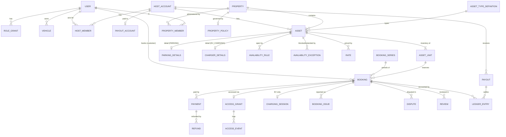
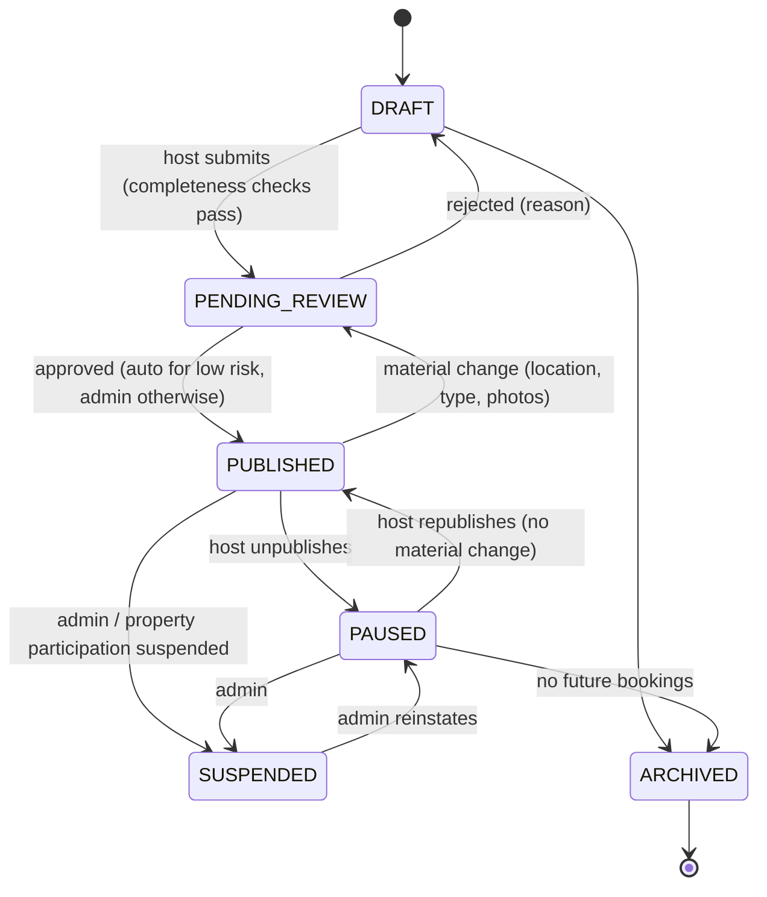
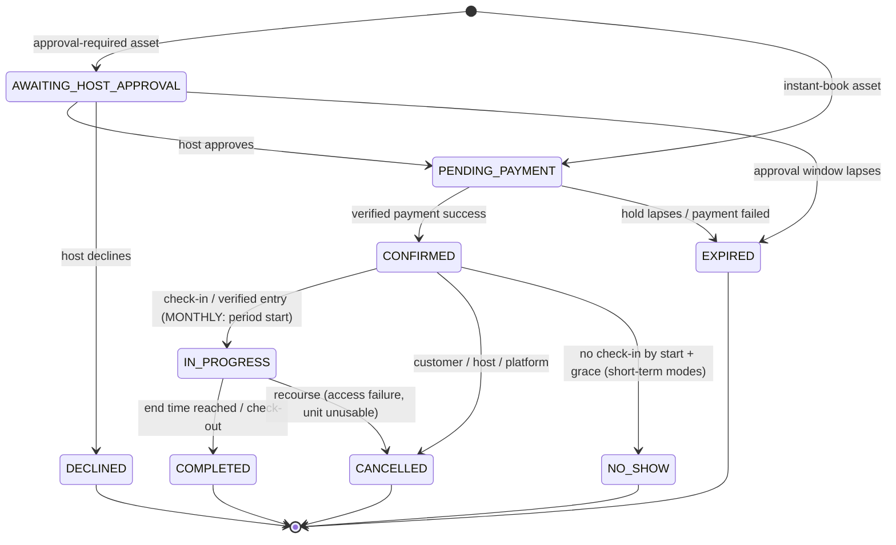

# Domain Model

Phase 2 output (2026-10-19). Defines the marketplace's entities, relationships, ownership, lifecycles, state machines and business rules. This is a **conceptual** model. Physical tables, columns, indexes and constraints are designed in Phase 6 (`database-design.md`), and module boundaries in Phase 5 (`architecture.md`).

Inputs: CLAUDE.md, [product-discovery.md](product-discovery.md), [core-user-journeys.md](core-user-journeys.md), [differentiation-strategy.md §4](differentiation-strategy.md#4-implications-for-upcoming-phases), [decision-log.md](decision-log.md) (D-009 pilot defaults, which are still proposed).

---

## 1. Design principles

1. **The core is asset-type-agnostic.** Availability, booking, pricing, payments, access, reviews and disputes reference `Asset`, never "parking" or "charger" directly. Type-specific data lives in type detail records described by an `AssetTypeDefinition`.
2. **Inventory is unit-based.** Every asset has one or more `AssetUnit`s. A booking reserves exactly one unit for a time range. One named slot = one unit. A commercial lot with 20 interchangeable spaces = 20 units. This makes double-booking prevention a simple per-unit, per-time-range rule that the database can enforce (D-012).
3. **State dimensions stay separate.** Booking lifecycle, payment, access, charging session and dispute each have their own entity and state machine (CLAUDE.md §12). No single "status" field carries everything.
4. **Snapshots over references for anything contractual.** Price, fees, commission, cancellation policy and property rules are copied onto the booking at commit time. Later edits never change an existing booking.
5. **Money is a ledger.** Integer minor units (paise), single currency INR at launch, immutable double-entry ledger entries. Corrections are made by reversal, never by update (D-016).
6. **Time is unambiguous.** Instants are stored in UTC. Recurring rules are expressed in the asset's local timezone (an IANA name, for example `Asia/Kolkata`). All intervals are half-open `[start, end)`.
7. **Private by default.** Exact location, access instructions and contact details are separate, protected data, revealed by explicit rules (§7).
8. **Every state transition is an event.** Transitions are recorded with actor, reason, timestamp and request ID (audit trail).

---

## 2. Entity overview

Supporting entities not drawn: `VerificationRecord`, `Notification`, `AuditEvent`, `CancellationPolicy`, `PlatformConfig`, `AssetMedia`, `Quote`.

---

## 3. Entities

### 3.1 Identity and parties

| Entity | Purpose | Key attributes | Notes |
|---|---|---|---|
| **User** | One person, one account | id (UUID), phone (verified, unique), email (optional), name, status (`ACTIVE`, `SUSPENDED`, `CLOSED`), trust level | One person can be customer, host and property admin at once |
| **RoleGrant** | Coarse role membership | user, role ∈ {`CUSTOMER`, `HOST`, `PROPERTY_ADMIN`, `PLATFORM_ADMIN`}, granted_at, granted_by | `CUSTOMER` is implicit for active users. Platform admins also hold fine-grained permissions (support, trust & safety, finance, super-admin, from personas A1–A4). |
| **Vehicle** | Customer's vehicle | owner user, registration number (normalised), vehicle class, dimensions class, is_ev, supported connectors, verification status | Registration number is personal data (§7). Unique per active owner. The same plate can't be active under two users without review. |
| **HostAccount** | The legal or business party that lists assets and receives money | id, kind ∈ {`INDIVIDUAL`, `BUSINESS`}, display name, legal name, tax identifiers (protected), verification level, status (`ACTIVE`, `RESTRICTED`, `SUSPENDED`) | Separates "who earns" from "who logs in". This supports H4 (facility manager with staff) and business payouts. |
| **HostMember** | User acting for a HostAccount | host account, user, role ∈ {`OWNER`, `MANAGER`} | `OWNER` can change payout details; `MANAGER` cannot |
| **PayoutAccount** | Where host money goes | host account, method (bank or UPI), masked details, verification status, changed_at | A change triggers re-verification and a payout hold (R-17) |

### 3.2 Property and assets

| Entity | Purpose | Key attributes |
|---|---|---|
| **Property** | A physical site containing assets | id, kind ∈ {`APARTMENT_SOCIETY`, `INDEPENDENT_HOUSE`, `COMMERCIAL`, `OFFICE`, `OTHER`}, exact address and geo point (**private**), public location (fuzzed point plus area label), timezone, participation status (§5.2), owning host account (for houses and commercial), created_by |
| **PropertyPolicy** | Society or property rules that constrain every asset inside it | allowed hours, max concurrent outsider vehicles (cap), allowed vehicle classes, allowed booking modes, host approval requirement (only approved residents may list), revenue share %, guard verification method, version |
| **PropertyMember** | Users administering a property | property, user, role ∈ {`ADMIN`, `MEMBER_HOST`}, approved_by, status |
| **AssetTypeDefinition** | Registry entry describing a type | code (`PARKING`, `EV_CHARGING`), detail schema reference, allowed booking modes, allowed pricing units, required verifications, required access capabilities, whether a charging or service session applies |
| **Asset** | A bookable listing | id, property, host account, asset type, title, description, rules text, status (§5.1), instant-book versus approval-required, buffer minutes, min and max duration per mode, lead time, cancellation policy reference, access instructions (**private**), version |
| **AssetUnit** | One reservable unit of an asset | asset, label (for example "B2-14", or "Space 3" for interchangeable spaces), status (`ACTIVE`, `INACTIVE`) |
| **ParkingDetails** | Type detail for `PARKING` | covered or open, level (basement, stilt, ground, open lot), max vehicle class, height and length limits, security features (CCTV, guard, gated), lighting, EV-ready socket flag, tandem flag |
| **ChargerDetails** | Type detail for `EV_CHARGING` | connector types (Type 2, CCS2, Bharat AC-001/DC-001, 15A socket, GB/T), current (AC/DC), rated power kW, cable provided, metering source ∈ {`NONE`, `HOST_REPORTED`, `CHARGER_API`}, integration reference (future smart charger), **plus the parking bay attributes** (it reuses the ParkingDetails shape) |
| **AssetMedia** | Photos | asset, kind (slot, entrance, charger), storage reference, order, moderation status |

**As built (Phase 9):** bay attributes for both types are stored in `ParkingDetails`; EV listings add `ChargerDetails` (D-070). Participation also allows PENDING_CONSENT → CONSENT_REQUIRED and WITHDRAWN → PENDING_CONSENT (D-066). A material change on a SUSPENDED listing keeps it suspended but marks it for review; REINSTATE returns it to PAUSED.

**EV modelling decision (D-013).** One physical space is one asset. A space with a charger is an `EV_CHARGING` asset whose unit includes the parking bay. It is never also listed as a separate `PARKING` asset, because two listings for one space would double-sell it. A `PARKING` asset may carry an "EV-ready socket" attribute for discovery, but charging is only sold through `EV_CHARGING` assets. If needed later, an `EV_CHARGING` asset can allow non-EV parking, but that's out of scope for the pilot.

### 3.3 Availability and pricing

| Entity | Purpose | Key attributes |
|---|---|---|
| **AvailabilityRule** | Recurring open windows | asset, days of week, local start and end time (may cross midnight, for example 19:00–09:00), valid_from and valid_to dates |
| **AvailabilityException** | One-off change | asset (or a specific unit), kind ∈ {`BLOCK`, `OPEN`}, `[start, end)` instants, reason, created_by |
| **Rate** | Price for a booking mode | asset, mode, unit price (paise), pricing unit ∈ {`PER_HOUR`, `PER_DAY`, `PER_NIGHT`, `PER_MONTH`, `PER_SESSION`}, overnight window (for `PER_NIGHT`), effective_from |
| **CancellationPolicy** | Versioned platform-defined policy templates | code (for example `FLEXIBLE`, `MODERATE`, `MONTHLY_STANDARD`), refund schedule, version |
| **PlatformConfig** | Versioned commission, fees, tax rules, hold timeouts, grace periods, recourse thresholds | key, value, version, effective_from |
| **Quote** | A deterministic, short-lived price calculation | customer, asset, mode, `[start, end)`, line items, totals, config versions used, expires_at |

**Booking modes:** `HOURLY`, `DAILY`, `OVERNIGHT`, `MONTHLY` for parking, and `CHARGING_SESSION` for EV (priced per hour or per session). Each asset type declares which modes it allows. Each asset enables a subset.

### 3.4 Booking

| Entity | Purpose | Key attributes |
|---|---|---|
| **Booking** | A reservation of one unit for one time range | id, customer, vehicle, asset, **unit**, host account, property, asset type (denormalised), mode, `[start, end)` (UTC), status (§5.3), price snapshot (line items), cancellation policy snapshot, property-policy snapshot, hold expires_at, idempotency key, series and period index (if recurring), rebooked_from (recourse), version |
| **BookingSeries** | A recurring or monthly arrangement | id, customer, vehicle, asset, unit (the same unit kept across periods), cadence (`MONTHLY` for the pilot), current period, status (§5.4), notice period days, renewal method, ended_reason |
| **BookingIssue** | Problem reported **during** a booking: the recourse path | booking, kind ∈ {`ACCESS_DENIED`, `UNIT_OCCUPIED`, `CHARGER_FAULTY`, `HOST_UNREACHABLE`, `LISTING_MISMATCH`, `OTHER`}, reporter, evidence references, status (§5.8), resolution ∈ {`RESOLVED_ON_SITE`, `REBOOKED`, `REFUNDED`, `ESCALATED_TO_DISPUTE`} |

A monthly series produces one `Booking` per period. Each period is an ordinary booking of the same unit, so availability, access, payment and ledger logic need no special cases. A weekday pattern (for example Mon–Fri 09:00–19:00) also fits as a series with one booking per occurrence. The pilot implements `MONTHLY` only (D-014).

### 3.5 Payments and money

| Entity | Purpose | Key attributes |
|---|---|---|
| **Payment** | One collection attempt from the customer | booking (or series period), provider, provider order and payment IDs, amount, status (§5.5), idempotency key, raw webhook references |
| **Refund** | Money returned to the customer | payment, amount, reason, initiated_by, status, provider refund ID |
| **LedgerEntry** | Immutable double-entry posting | journal ID, account, direction (debit or credit), amount, booking, payment, refund or payout reference, created_at |
| **Payout** | Transfer to the host's payout account | host account, payout account, amount, status (§5.6), provider reference, included ledger entries |

**Ledger accounts (conceptual):** `customer_clearing`, `platform_revenue:commission`, `platform_revenue:service_fee`, `tax_payable:*`, `host_payable:{host}`, `society_payable:{property}`, `gateway_fees`, `refunds`, `host_receivable:{host}` (negative balance). The payment, the commission, the taxes, the host's share, the society share and the payout are always separate postings (CLAUDE.md §8, §16).

### 3.6 Access and charging

| Entity | Purpose | Key attributes |
|---|---|---|
| **AccessGrant** | Authorisation to enter for one booking | booking, method ∈ {`BOOKING_CODE`, `VEHICLE_NUMBER`, `QR`, `SOCIETY_VISITOR_SYSTEM`}, credential (stored hashed for codes), valid `[from, until)` = booking range ± grace, status (§5.7), adapter reference |
| **AccessEvent** | Something that happened at the gate or slot | grant, kind ∈ {`VERIFIED`, `DENIED`, `ENTERED`, `EXITED`, `FAILURE_REPORTED`}, source (guard lookup, host, customer, adapter), timestamp |
| **ChargingSession** | The charging part of an `EV_CHARGING` booking | booking, status (§5.9), started_at and ended_at (self-reported or integration), energy kWh (nullable), metering source, fault reason |

**Access mechanism abstraction (CLAUDE.md §17).** `AccessGrant.method` selects an adapter. Each adapter issues credentials, verifies them and emits `AccessEvent`s. Future adapters (smart lock, ANPR, gate systems) plug in without changing `Booking`.

**Charger integration abstraction (CLAUDE.md §4).** A `ChargerIntegration` interface (`getStatus`, `startSession`, `stopSession`, `readEnergy`) exists conceptually. The only pilot implementation is `MANUAL` (self-reported). **As built (Phase 14):** `charging/domain/integration.ts`, selected per charger by `integration_kind` (D-115); sessions in `charging.charging_sessions` (D-114, D-116).

### 3.7 Trust, reviews and disputes

| Entity | Purpose | Key attributes |
|---|---|---|
| **VerificationRecord** | A verification of any subject | subject (user, host account, vehicle, property, asset), kind (phone, email, identity, vehicle registration, right to rent, society consent, photo check), status ∈ {`PENDING`, `VERIFIED`, `REJECTED`, `EXPIRED`}, evidence reference (protected), reviewer, expires_at |
| **Review** | One-directional review of a completed booking | booking, direction ∈ {`CUSTOMER_TO_HOST`, `HOST_TO_CUSTOMER`}, overall rating, dimension ratings (accuracy, access, communication, safety, reliability), text, status (§5.10) |
| **Dispute** | Formal claim needing resolution | booking, opened_by, category (unavailable, incorrect listing, access failure, vehicle damage, property damage, charger failure, billing, no-show, host cancellation, misconduct), **risk level** ∈ {`LOW`, `MEDIUM`, `HIGH`}, status (§5.11), evidence, assigned admin, outcome, monetary adjustments |
| **RiskSignal / RiskFlag / Restriction** | Fraud and abuse foundation (Phase 4) | See [trust-and-safety.md §5](trust-and-safety.md#5-fraud-detection-foundation). Restrictions (`NO_NEW_BOOKINGS`, `NO_PUBLISH`, `PAYOUT_HOLD`, `SUSPENDED`) are checked by booking, publishing and payout logic. |
| **AuditEvent** | Who did what | actor (user, system or admin), action, entity, before and after (PII-redacted), request ID, timestamp |
| **Notification** | Outbound message record (Phase 18) | recipient, event, channel, dedup key, status |

---

## 4. Ownership and authorisation

All checks run on the server. "Own" means the actor is a member of the owning `HostAccount` or `Property`, or is the booking's customer.

| Entity | Create | Read | Update / transition |
|---|---|---|---|
| Vehicle | Customer (own) | Own; host of a confirmed booking (plate and class only); platform admin | Own |
| HostAccount | Any verified user | Members; platform admin | `OWNER` member; platform admin (status) |
| PayoutAccount | Host `OWNER` | Host `OWNER` (masked); finance admin | Host `OWNER` (triggers hold) |
| Property | Host (house or commercial); property admin or platform admin (society) | Public fields to everyone; private fields per §7 | Owning host or property admin; platform admin |
| PropertyPolicy | Property admin; platform admin | Property admin; hosts in the property; customers see the effective rules | Property admin (versioned; applies to new bookings) |
| Asset / Unit / Rules / Rates | Host member (and, in a society, an approved `MEMBER_HOST`) | Published asset: public fields to everyone. Draft: host and admin. | Host member; platform admin (suspend) |
| Booking | Customer | Customer, host members, property admin (limited: vehicle, time, unit), platform admin | System and state machine only. Actors request transitions (cancel, check-in); the booking engine applies them. |
| Payment / Refund | System (booking engine, webhooks) | Customer (own), host (totals only), finance admin | **System only, from verified provider events.** Never by a client or an AI. |
| LedgerEntry / Payout | System | Host (own earnings view), finance admin | System; finance admin approves payout runs |
| AccessGrant / Event | System | Customer (own credential), host, property admin and guard lookup (yes/no plus unit), platform admin | System and adapters |
| BookingIssue | Customer or host on an active booking | Parties; support admin | Parties (add evidence); support admin |
| Dispute | Customer or host within the dispute window | Parties (limited); admins | Admins resolve. **High-risk disputes need a human decision** (CLAUDE.md §18). |
| Review | Booking parties after completion | Public once published | Author (until published); trust & safety admin (moderate) |

---

## 5. Lifecycles and state machines

Each machine lists every allowed transition. Anything not listed is rejected. States are an enumerated type in code, never ad-hoc strings (CLAUDE.md §12).

### 5.1 Asset

- **Publish preconditions:** required type details complete; at least one photo; at least one availability rule; a rate for each enabled mode; required verifications met for the risk level (Phase 4); property participation is `NOT_REQUIRED` or `PARTICIPATING`; host account `ACTIVE`; payout account present.
- `PAUSED` and `SUSPENDED` stop **new** bookings only. Existing bookings remain valid unless explicitly cancelled through the booking engine.
- `ARCHIVED` requires no future `CONFIRMED` bookings.

### 5.2 Property participation

| State | Meaning |
|---|---|
| `NOT_REQUIRED` | Independent house or commercial property controlled by the host |
| `CONSENT_REQUIRED` | Apartment society not yet onboarded. Assets can be drafted but **not published** (D-009). |
| `PENDING_CONSENT` | Society onboarding in progress |
| `PARTICIPATING` | Society agreed. Its PropertyPolicy applies. |
| `SUSPENDED` | Temporarily halted by the society or platform. No new bookings. |
| `WITHDRAWN` | The society exited. Assets are suspended. Existing bookings are honoured up to the end of the current period or notice, whichever is earlier (open question Q-3). |

Transitions: `CONSENT_REQUIRED → PENDING_CONSENT → PARTICIPATING ↔ SUSPENDED`; `PARTICIPATING | SUSPENDED → WITHDRAWN`.

### 5.3 Booking

- **Unit-holding states** (they block availability): `AWAITING_HOST_APPROVAL`, `PENDING_PAYMENT` (until hold expiry), `CONFIRMED`, `IN_PROGRESS`.
- **Terminal states:** `COMPLETED`, `CANCELLED`, `EXPIRED`, `DECLINED`, `NO_SHOW`.
- `CANCELLED` carries `cancelled_by` ∈ {`CUSTOMER`, `HOST`, `PLATFORM`}, a reason code (including `RECOURSE_ACCESS_FAILURE`) and the refund decision.
- **Overstay** isn't a state. It's an `OVERSTAY` adjustment recorded against a `COMPLETED` booking (BR-27).
- Only the payment webhook path (or server-side reconciliation with the provider) may move a booking from `PENDING_PAYMENT` to `CONFIRMED`.
- Short-term bookings enter `IN_PROGRESS` on check-in or a verified entry `AccessEvent`. Monthly periods enter it automatically at period start. This keeps `NO_SHOW` reachable (BR-26).
- A booking that's still `CONFIRMED` at its end time with no access event, open issue or dispute goes to `NO_SHOW` (short-term) or `COMPLETED` (monthly).

### 5.4 BookingSeries (monthly)

| From | To | Trigger |
|---|---|---|
| (new) | `ACTIVE` | First period booking `CONFIRMED` |
| `ACTIVE` | `ACTIVE` | Next period booking created and paid before the period starts |
| `ACTIVE` | `PAST_DUE` | Renewal payment not received by the renewal deadline |
| `PAST_DUE` | `ACTIVE` | Payment received within the grace period |
| `PAST_DUE` | `ENDED` | Grace lapses. The unit is released after the current period. |
| `ACTIVE` | `NOTICE_GIVEN` | Customer or host gives notice |
| `NOTICE_GIVEN` | `ENDED` | Notice period elapses (ends at a period boundary) |
| `ACTIVE`, `PAST_DUE`, `NOTICE_GIVEN` | `ENDED` | Platform termination (safety or fraud) or property `WITHDRAWN` |

The renewal booking for period *n+1* is created (holding the same unit) when period *n* starts. That reserves the unit ahead of time, so no one else can take it before renewal.

### 5.5 Payment

`CREATED → PENDING → SUCCEEDED | FAILED | EXPIRED`. Refunds are tracked on `Refund` (`PENDING → SUCCEEDED | FAILED`). A payment's refunded total is derived from its refunds.

- `SUCCEEDED` is set **only** from a signature-verified provider webhook or a server-side status query to the provider (reconciliation). Never from the client.
- **Late success** (the provider confirms after the booking `EXPIRED`): if the same unit is still free for the same range, confirm the booking. Otherwise the booking stays `EXPIRED` and a full refund is issued automatically (BR-15).

### 5.6 Payout and host earnings

Host earnings are ledger balances that move through: **`PENDING`** (booking not yet completed, or within the dispute window) → **`AVAILABLE`** → **`IN_PAYOUT`** → **`PAID`**.

Payout states: `SCHEDULED → PROCESSING → PAID | FAILED`; `FAILED → SCHEDULED` (retry after fixing details); any non-final state can go to `ON_HOLD` (open dispute, payout-details change, fraud flag), and `ON_HOLD → SCHEDULED`.

### 5.7 AccessGrant

`ISSUED` (at confirmation) → `ACTIVE` (from the window start) → `USED` (first verified entry) → `EXPIRED` (after the window). From any non-final state: `REVOKED` (booking cancelled, safety). For monthly bookings, a series-level grant is renewed per period.

### 5.8 BookingIssue (recourse)

`OPEN → HOST_NOTIFIED → RESOLVED_ON_SITE | REBOOKED | REFUNDED | ESCALATED`. If the host doesn't resolve the issue within the configured response window, the platform resolves it automatically to `REFUNDED`, with a rebooking offer (BR-24).

### 5.9 ChargingSession

`NOT_STARTED → CHARGING → COMPLETED`; `CHARGING → STOPPED_EARLY` (customer); `NOT_STARTED | CHARGING → FAULTED` (charger fault reported, which opens a BookingIssue `CHARGER_FAULTY`).

### 5.10 Review

`ELIGIBLE` (booking `COMPLETED`) → `SUBMITTED` (hidden) → `PUBLISHED` (when both sides have submitted, or the review window closes) → `REMOVED` (moderation). `ELIGIBLE → LAPSED` if not written within the window. Hiding reviews until both sides submit reduces retaliation.

### 5.11 Dispute

`OPEN → UNDER_REVIEW ↔ AWAITING_INFO → RESOLVED → CLOSED`; `UNDER_REVIEW → ESCALATED` (senior or trust & safety). `HIGH`-risk disputes (damage, safety, misconduct) can only reach `RESOLVED` through a platform admin decision. Rule-based or AI suggestions are advisory only.

---

## 6. Business rules

### Availability
- **BR-01: Availability of a unit for `[s, e)`** = within the asset's AvailabilityRules (local time) **∩** the PropertyPolicy's allowed hours **−** BLOCK exceptions **+** OPEN exceptions **−** ranges held by unit-holding bookings, each extended by the asset's buffer on both sides. Computed deterministically by the availability engine. Never by an LLM (CLAUDE.md §13).
- **BR-02:** Intervals are half-open. A booking ending 10:00 and one starting 10:00 don't overlap. With a buffer of *b* minutes, the next booking can start at 10:00 + *b*.
- **BR-03:** Rule windows can cross midnight (for example 19:00–09:00). Each window is expanded to concrete instants in the asset's timezone before comparison, never by adding fixed offsets.
- **BR-04:** A host BLOCK can't overlap a unit-holding booking. To free that time, the host must cancel the booking through the engine (BR-21).
- **BR-05:** Asset-level availability = at least one unit available. Discovery shows availability per asset. Booking allocates a specific unit.
- **BR-06: Property cap.** If PropertyPolicy sets a maximum number of concurrent outsider vehicles, a booking can be committed only if, across all assets in the property, fewer than the cap overlap `[s, e)`. This is a cross-asset check, so it must run inside the same transaction with property-level serialisation (Phase 6 and 12).

> **As built (Phase 11):** BR-01 to BR-05 are implemented by the pure availability engine (D-084). BR-04 additionally refuses a block that overlaps a booking's buffer (D-087). BR-06's max-simultaneous count is implemented (`maxConcurrent`) and enforced at booking commit in Phase 12 (D-090).

### Booking creation
- **BR-07:** Flow: `Quote` (deterministic price) → validate (vehicle compatibility, modes, durations, lead time, property policy, customer and host status) → **in one transaction:** re-check availability and the property cap, allocate a unit, insert the booking (`PENDING_PAYMENT` or `AWAITING_HOST_APPROVAL`), snapshot price and policies → create the payment.
- **BR-08:** Two unit-holding bookings for the same unit must never overlap. Enforced in application logic **and** by a database constraint (D-003, Phase 6).
- **BR-09:** Every create-booking request carries an idempotency key, scoped to the customer. A retry returns the original result.
- **BR-10:** The `PENDING_PAYMENT` hold expires after the configured timeout (proposed 10 minutes). A hold past its `expires_at` **never blocks availability**, even before a background job has marked it `EXPIRED`. The booking transaction expires any lapsed conflicting holds before re-checking (Phase 12 must also handle this at the DB-constraint level). The approval window for `AWAITING_HOST_APPROVAL` is configurable (proposed 12 hours, and never past the start time).
- **BR-11:** If the quote expired or the price inputs changed, the booking is rejected with a re-quote. The customer is always charged exactly the total they confirmed.
- **BR-12: Vehicle compatibility.** The vehicle class must be ≤ the asset's maximum vehicle class and satisfy its dimension limits. For `EV_CHARGING`, the vehicle must be an EV and at least one vehicle connector must match a charger connector.
- **BR-13: Mode constraints.** `HOURLY` within the asset's min and max hours. `DAILY` in whole days. `OVERNIGHT` covers exactly the asset's overnight window. `MONTHLY` runs from the start date to the same local time one calendar month later (period 1), then repeats. If that day doesn't exist in the target month, it falls on the month's last day (31 Jan → 28/29 Feb), and later periods keep the original anchor day where it exists. `CHARGING_SESSION` within the min and max hours.
- **BR-14: Instant-book default.** Assets use instant booking unless the host enables approval. Approval is recommended for `MONTHLY` (D-017).

### Payments and money
- **BR-15:** Booking confirmation and refunds react to verified provider events only. Late success on an expired booking: reconfirm if the unit is still free, otherwise refund automatically.
- **BR-16:** All amounts are integers in paise. The price snapshot lists the base price, customer service fee, taxes on platform fees and the total. The host earnings snapshot lists the base price, host commission, withheld taxes, society share and net.
- **BR-17:** Commission, fee and tax rates come from the PlatformConfig version active at booking commit. They're stored on the booking and never recomputed from current config.
- **BR-18:** Host earnings for a booking become `AVAILABLE` only after it's `COMPLETED` and the dispute window has passed with no open dispute.
- **BR-19:** A refund or adjustment after payout creates a `host_receivable` (negative balance), which is offset against future payouts.
- **BR-20:** The society share is accrued per booking when the PropertyPolicy specifies one. It's a separate ledger line and payee.

### Cancellation and changes
- **BR-21: Host cancellation** of a confirmed booking gives the customer a full refund and records a host reliability event (penalties defined in Phase 19). Repeated cancellations restrict the host.
- **BR-22: Customer cancellation:** the refund is calculated from the booking's **snapshot** cancellation policy and the time remaining before start. It's shown before confirmation and is idempotent.
- **BR-23:** Price or rule changes apply only to bookings committed after the change. Material asset changes (location, type) on a published asset trigger re-review. Existing bookings keep their snapshot, but customers with upcoming bookings are notified.

### Recourse, arrival and completion
- **BR-24: Recourse promise.** A BookingIssue of kind `ACCESS_DENIED`, `UNIT_OCCUPIED`, `CHARGER_FAULTY` or `HOST_UNREACHABLE`, raised during the booking's access window, notifies the host. If it isn't resolved within the configured response window (proposed 15 minutes), the booking is `CANCELLED` (reason `RECOURSE_*`) with a full refund and an offer to rebook. A rebooked booking links via `rebooked_from`. The host is accountable unless evidence shows customer fault.
- **BR-25: Access validity.** An access credential verifies only for its booking's unit and property, within `[start − early grace, end + late grace)`, and only while the booking is `CONFIRMED` or `IN_PROGRESS`.
- **BR-26: No-show.** For short-term modes, no check-in or verified entry by start + no-show grace makes the booking `NO_SHOW`. The refund follows the policy (typically none), and the unit is released for the remaining time. An open BookingIssue suspends no-show processing, so a customer stuck at the gate is never marked a no-show. A customer can contest a no-show through a dispute.
- **BR-27: Overstay.** An exit event, or a host report after end + late grace, creates an `OVERSTAY` adjustment priced by the asset's rate and policy. How it's collected is resolved in Phase 15 (open question Q-5).
- **BR-28: EV charging sessions** are bounded by the booking. Without metering, price is per hour or per session (D-005), and energy is informational only.

### Trust, reviews and disputes
- **BR-29:** Reviews require a `COMPLETED` booking. One per direction per booking.
- **BR-30:** A dispute must be opened within the dispute window (proposed 72 hours after the end). An open dispute holds the related host earnings.
- **BR-31:** `HIGH`-risk disputes are resolved only by a human admin. Every resolution and monetary adjustment is audited.
- **BR-32:** In a `PARTICIPATING` society, only hosts approved by the property admin (`MEMBER_HOST`) may publish assets there. Elsewhere, hosts must attest their right to rent (VerificationRecord kind `RIGHT_TO_RENT`).
- **BR-33: Verification gating.** A booking risk level (LOW, MEDIUM or HIGH) is computed deterministically at quote time ([trust-and-safety.md §4.1](trust-and-safety.md#41-customer-requirements-by-booking-risk)). Commit is refused unless the customer holds the required verifications and has no blocking `Restriction`.

---

## 7. Information visibility (location privacy, CLAUDE.md §11)

> **Superseded in detail by [trust-and-safety.md §9 and §11](trust-and-safety.md#11-information-visibility-final)** (Phase 4), which is authoritative. Differences from the table below: host sees the customer's first name + last initial; plates are masked 30 days after end; commercial properties use a 0–100 m offset and may show a pin.

| Data | Before booking | After confirmation | During access window | After completion |
|---|---|---|---|---|
| Public location (fuzzed point, area label, distance) | Everyone | Everyone | Everyone | Everyone |
| Exact address, geo point, entrance photo | Host, property admin, permitted admin | **+ booking customer** | + booking customer | Customer loses access after end + 24 h |
| Access instructions, unit label | Host, permitted admin | + booking customer | + booking customer | Hidden from customer |
| Host phone | Never shown directly. Masked relay only during the booking. | Masked relay | Masked relay | Closed |
| Customer name and vehicle plate | n/a | Host, property admin (plate and class), guard lookup (yes/no plus unit) | Same | Host keeps the booking record; plate is masked in the host UI after the retention period |
| Customer phone | Never to host | Masked relay | Masked relay | Closed |

**Fuzzed public location:** each property gets a **stable** random offset (proposed 200–500 m), so repeated searches can't be averaged to reveal the real point. Distances in search results use the fuzzed point, rounded. Finalised in Phase 4 ([trust-and-safety.md §9](trust-and-safety.md#9-location-privacy-final-rules-resolves-d-018)). Enforcement and tests are in Phase 10.

---

## 8. Extensibility check: adding a future asset type

Worked example: **`CAR_WASH_BAY`**, which isn't implemented.

| Needed | Change |
|---|---|
| Type registration | New `AssetTypeDefinition` (allowed modes: `APPOINTMENT`; pricing unit: `PER_SESSION`; session applies) |
| Type details | New `CarWashDetails` record (wash types, water source, covered) |
| Booking mode | Add `APPOINTMENT` to the mode enumeration, with duration rules |
| Session | A `ServiceSession` similar to `ChargingSession`, or generalise `ChargingSession` into a typed session when a second session type actually exists |
| Discovery filters | Type-specific filter set |
| **Unchanged** | User, HostAccount, Property, Asset, AssetUnit, Availability, Booking, BookingSeries, Payment, Ledger, Payout, AccessGrant, Review, Dispute, BookingIssue |

The core marketplace needs no rewrite. That meets the Phase 2 acceptance criterion.

---

## 9. Model validation scenarios

These are design-level checks of the model against the hard cases. Each one becomes an automated test in the implementing phase.

| # | Scenario | Outcome under the model | Rules |
|---|---|---|---|
| V1 | Two customers book the same single-unit asset for overlapping times at the same instant | The first commit wins. The second fails the in-transaction re-check or the DB constraint and gets "no longer available" with alternatives. | BR-07, BR-08 |
| V2 | Commercial lot with 20 units, 21st concurrent request | A unit is allocated for each of the first 20. The 21st fails. | BR-05, BR-08 |
| V3 | Back-to-back bookings 08:00–10:00 and 10:00–12:00, buffer 15 min | The second must start ≥ 10:15. With buffer 0 it's allowed. | BR-02 |
| V4 | Availability rule 19:00–09:00 on Fridays, booking Fri 22:00 → Sat 08:00 | Valid. The window is expanded across midnight in the asset's timezone. | BR-03 |
| V5 | Society cap = 5 outsider vehicles; 5 bookings across 3 hosts' assets overlap 10:00–12:00 | A 6th overlapping booking is rejected even though a unit is free. | BR-06 |
| V6 | Customer retries "Book" after a network timeout | The same booking is returned. No second hold, no second payment. | BR-09 |
| V7 | Payment webhook arrives after hold expiry and the unit was taken | The booking stays `EXPIRED`. An automatic full refund follows, and the customer is notified. | BR-15 |
| V8 | Duplicate webhook delivered twice | The second is a no-op (idempotent on provider event ID). | BR-15 |
| V9 | Host raises the price after a booking is confirmed | The booking is unaffected (snapshot). | BR-17, BR-23 |
| V10 | Host tries to block time that overlaps a confirmed booking | Rejected. The host must cancel through the engine, which triggers a full refund and a reliability event. | BR-04, BR-21 |
| V11 | Guard denies entry; host doesn't respond in 15 min | Auto-cancel `RECOURSE_ACCESS_DENIED`, full refund, rebooking offer. The host is accountable. | BR-24 |
| V12 | Monthly renewal payment fails | Series goes to `PAST_DUE`. The unit is still held through the grace period. If grace lapses, it goes to `ENDED` and the unit is released after the current period. | §5.4 |
| V13 | Refund on a dispute after the host was paid | A `host_receivable` is created and offset from the next payout. | BR-19 |
| V14 | A non-EV car tries to book an `EV_CHARGING` asset; an EV with a CCS2-only connector tries a Type 2-only charger | Both are rejected at validation. | BR-12 |
| V15 | Society withdraws while monthly series are active | Assets are `SUSPENDED`, no new bookings. Existing series end per the withdrawal policy (open question Q-3). | §5.2 |
| V16 | A customer's access code is used the day after their booking | Verification fails (outside the window, booking `COMPLETED`). A `DENIED` event is logged. | BR-25 |
| V17 | An apartment owner in a `CONSENT_REQUIRED` society tries to publish | Blocked. The draft is kept. | §5.1, §5.2, BR-32 |
| V18 | Charger fails mid-session | ChargingSession goes to `FAULTED`. BookingIssue `CHARGER_FAULTY` opens and the recourse rule applies. | §5.9, BR-24 |

---

## 10. Out of scope here (deliberately)

- Physical schema, indexes, PostGIS and exclusion-constraint DDL (Phase 6).
- Exact numbers for timeouts, grace periods, windows and penalties. Proposed values above are defaults to confirm in Phases 4, 12 and 19.
- Tax computation detail (Phase 15 and 16, after CA review).
- Request-to-book for short-term modes, weekday-recurring series, 2W/3W vehicle classes, non-EV parking on `EV_CHARGING` assets. The model supports them, but they won't be built for the pilot.

## 11. Open questions raised in Phase 2

| ID | Question | Default until answered |
|---|---|---|
| Q-1 | Should `MONTHLY` require host approval by default? | Yes, host approval recommended (D-017) |
| Q-2 | Monthly notice period length | 15 days, at a period boundary |
| Q-3 | When a society withdraws, are active monthly series honoured until the period ends? | Honoured until the current period ends |
| Q-4 | Recourse host response window | 15 minutes |
| Q-5 | How overstay charges are collected (UPI has no card-style pre-authorisation) | Decide in Phase 15. Options: a deposit, or a charge request after the fact. |
| Q-6 | Customer service fee and host commission rates | Set in Phase 15/16 (D-010) |
